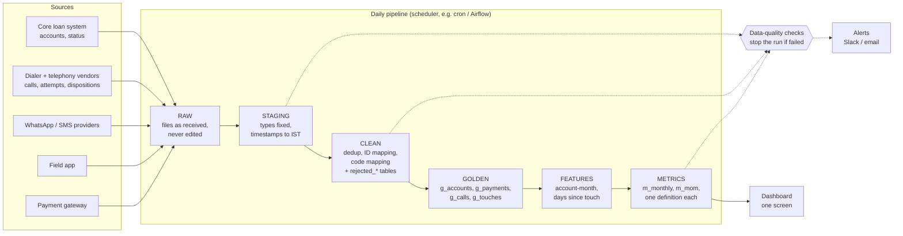

# Production Design

How this analysis would run every day for the leadership team. I kept it to tools a small team can actually run: the same SQL files, a scheduler, and a database.

## Architecture

## Layers

| Layer | What happens | Example in this repo |
|---|---|---|
| Raw | Files land exactly as sent. Never changed, kept 2 years | `collections_30k_dataset/` |
| Staging | Types, IST timestamps, phone cleanup. **No rows dropped** | `sql/01_staging.sql` |
| Clean | Dedup, entity resolution, code mapping. Every dropped row goes to a `rejected_*` table with a reason | `sql/02_clean.sql` |
| Golden | Business-ready facts. Only SUCCESS payments | `sql/03_golden.sql` |
| Features | Per account per month: touches, days since touch, DPD bucket | part of `03` / `06` |
| Metrics | One definition per metric, in one place | `sql/04_metrics.sql` |
| Dashboard | Reads metrics only, never raw | `dashboard/index.html` |

## Data contracts (what each source must send)
| Source | Required fields | Rule |
|---|---|---|
| Payments | payment_id, account_id, amount, status, event_at **with timezone** | status ∈ {SUCCESS, FAILED, PENDING, REVERSED}; reversals must reference the original payment_id |
| Calls | call_id, account_id, agent_id, vendor_id, event_at, timezone | one row per call_id |
| Dispositions | call_id, code, **version** | code must exist in the mapping table |
| Agents | agent_id (canonical), employee_code | one active employee_code per agent_id |

A file that breaks its contract is **quarantined**, not loaded, and the source team is alerted.

## Primary keys
`payment_id`, `call_id`, `attempt_id`, `whatsapp_event_id`, `sms_event_id`, `visit_id`, `ptp_id`, `account_id`, `borrower_id`, `agent_id`. Uniqueness of each is tested on every run.

## Metric definitions
Owned in `sql/04_metrics.sql`; the dashboard never computes its own. The key ones:
- **Recovery** = SUCCESS de-duplicated payments, reported **per day**
- **Recovery rate** = recovery ÷ outstanding of the **full allocated book**
- **PTP kept rate** = kept ÷ all promises that fell due
- **Channel credit** = touch within 7 days before payment

## Incremental processing
- Event tables are processed by **event date partition**. Each run reprocesses the **last 10 days**, so late events land in the right day.
- Dimension tables (accounts, agents) are snapshotted daily. We keep history instead of overwriting, which fixes the overwritten-status problem.

## Late-arriving data
- Each metric for a closed month is marked **provisional** until 10 days after month end, then **final**.
- The dashboard shows a "provisional" tag so nobody compares an incomplete month with a full one. That is exactly what happened with August.

## Backfills
- All SQL is idempotent (`CREATE OR REPLACE`), so a backfill = rerun for a date range.
- When a definition changes (e.g. a new disposition version), history is recomputed **and** the old version is kept for one quarter, so the change can be explained.

## Data-quality checks (run every day, block the run on failure)
| Check | Catches | Found in this data? |
|---|---|---|
| Primary key unique | Duplicate payments / calls | Yes: 500 payments, 1,350 calls |
| Status in allowed list; amount > 0 | Bad payment rows | – |
| Timezone present and valid | Wrong hour/day | Yes: 3 timezones mixed |
| Disposition code in mapping table | New vendor codes | Yes: 3 versions |
| One employee_code per agent_id | Agent identity splits | Yes: 1,099 codes shared |
| `recorded_at >= event_at` | Clock / ingest errors | Yes: 50% of status history |
| Row count within ±20% of 28-day average | Missing or doubled files | – |

## Monitoring and anomaly detection
- **Per-day recovery** vs its 28-day average: alert if outside ±3 standard deviations (normal noise is ±1.8%).
- **Share of non-SUCCESS payments**, duplicate rate and contract failures tracked daily.
- **Month-length guard:** any month-on-month comparison is auto-normalised per day, which prevents another "11%".
- Pipeline freshness: alert if any source hasn't arrived by 7am IST.
